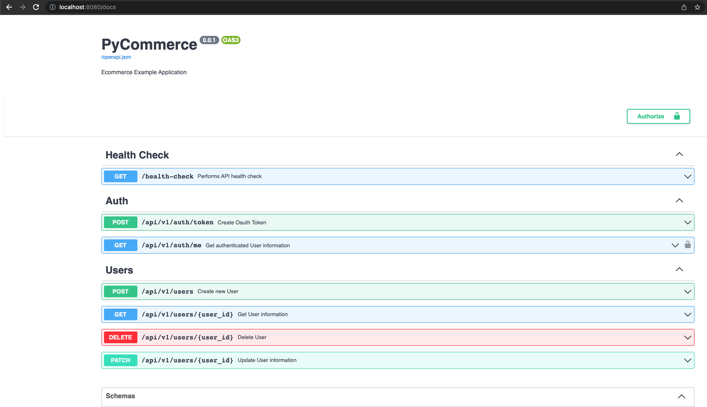
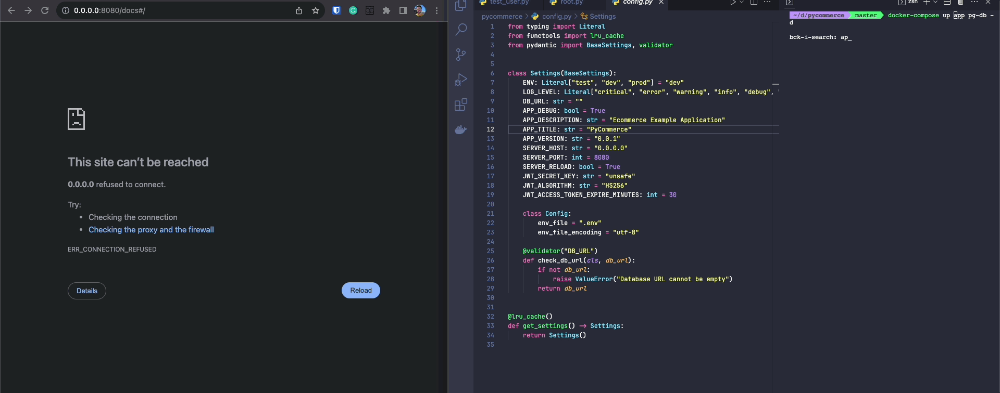
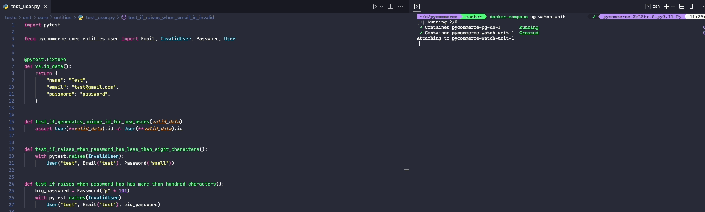

# Python Clean Architecture

## Descripción General

<p align="left">
  <a href="https://skillicons.dev">
    
  </a>
</p>

Plantilla moderna de Python lista para producción que presenta **Arquitectura Limpia (Clean Architecture)**, **Diseño Guiado por el Dominio (DDD)** y **FastAPI**. Demuestra cómo estructurar aplicaciones con una separación adecuada de responsabilidades, pruebas exhaustivas y seguridad de tipos.

## Stack Tecnológico

Esta plantilla proporciona una base sólida que puede extenderse fácilmente para cualquier dominio. Incluye:

- Lenguaje: [Python 3.12](https://www.python.org/)
- Contenedores: [Docker](https://www.docker.com/), y [Docker Compose](https://docs.docker.com/compose/)
- Gestión de paquetes: [Poetry](https://python-poetry.org/)
- Framework web: [FastAPI](https://fastapi.tiangolo.com/)
- Servidor web: [Uvicorn](http://www.uvicorn.org/)
- Base de datos: [Postgres](https://www.postgresql.org/)
- Migraciones de base de datos: [Alembic](https://alembic.sqlalchemy.org/en/latest/)
- ORM: [SQLModel](https://sqlmodel.tiangolo.com/)
- Encriptación de contraseñas: [Passlib](https://passlib.readthedocs.io/)
- Autenticación: [OAuth2 + JWT](https://fastapi.tiangolo.com/tutorial/security/oauth2-jwt/)
- Pruebas: [Pytest](https://docs.pytest.org/en/latest/)
- Linter: [Ruff](https://github.com/astral-sh/ruff)
- Comprobador de tipos: [Mypy](https://mypy.readthedocs.io/en/stable/index.html)
- Formateador de código: [Ruff](https://github.com/astral-sh/ruff)
- Ganchos pre-commit: [Pre-commit](https://pre-commit.com/)
- Recarga en caliente para [desarrollo](#hot-reload), modo [observación](#watch-mode-for-tests) para pruebas, soporte completo para [Asyncio](https://docs.python.org/3/library/asyncio.html), etc...

## Qué incluye

- **Gestión de Usuarios**: Operaciones CRUD completas para usuarios con DTOs y casos de uso adecuados
- **Sistema de Autenticación**: Autenticación basada en JWT con soporte para OAuth2
- **Estructura de Arquitectura Limpia**: Capas bien organizadas con límites claros
- **Objetos de Valor**: Objetos de valor para Email, Password e ID (validados con UUID) con validación incorporada
- **Patrón Repositorio**: Interfaces abstractas con implementaciones concretas
- **Patrón Unidad de Trabajo**: Gestión de transacciones entre repositorios
- **Manejo Centralizado de Excepciones**: Excepciones específicas del dominio para una mejor gestión de errores
- **Pruebas Exhaustivas**: Pruebas unitarias con mocks y pruebas de integración
- **Herramientas de Desarrollo**: Recarga en caliente, modo de observación para pruebas y ganchos pre-commit

📚 **Documentación:**
- [Preguntas Frecuentes y Guía de Arquitectura](docs/FAQ.md) - Resumen de la arquitectura y preguntas comunes

## Uso

Si bien es posible ejecutar la aplicación localmente solo con Python, se recomienda encarecidamente instalar [Docker](https://www.docker.com/) para mantener tu entorno local limpio y facilitar el uso de todas las funciones.

### Configuración

La aplicación utiliza variables de entorno para su configuración. Puedes consultar todas las opciones disponibles [aquí](app/config.py). Puedes crear y completar un archivo `.env` utilizando el archivo [.env.example](.env.example) como referencia, o establecerlas manualmente de la siguiente manera:

```sh
export DB_URL="<database_url>"
export JWT_SECRET_KEY="<my_super_secret_key>"
...
```

Si usas Docker, simplemente edita las variables de entorno en [docker-compose.yml](./docker-compose.yml).

### Instalación

Activa tu [entorno virtual](https://docs.python.org/3/library/venv.html) de Python y ejecuta:

```sh
poetry install

# o

pip install .
```
### Verificación de Tipos

```sh
mypy app tests
```

### Linting

```sh
ruff check .
```

### Formateo de Código

```sh
ruff format app tests/
```

### Ganchos Pre-commit

La plantilla utiliza ganchos pre-commit para ejecutar automáticamente el linting, el formateo y la verificación de tipos antes de los commits:

```sh
# Instalar ganchos pre-commit (ejecutar una vez después de clonar)
make pre-commit-install

# Ejecutar todos los ganchos pre-commit manualmente
make pre-commit-run

# Los ganchos se ejecutarán automáticamente en git commit
# Para omitirlos temporalmente: git commit --no-verify
```

### Iniciar la Aplicación

⚠️ Si no usas Docker, recuerda ejecutar el [init.sql](scripts/pg/init.sql) en tu base de datos local antes de ejecutar la aplicación.

```sh
# Desarrollo local (requiere PostgreSQL local)
alembic upgrade head && poetry run app

# o
alembic upgrade head && python -m app

# con Docker - Build de producción (imagen optimizada)
docker compose up app pg-db -d

# con Docker - Build de desarrollo (con recarga en caliente y dependencias de desarrollo)
docker compose up app-dev pg-db -d

# Usando comandos de Make
make docker-up          # Configuración Docker de producción
make docker-up-dev      # Configuración Docker de desarrollo con recarga en caliente
```

Luego, abre el navegador en [http://localhost:8080/docs](http://localhost:8080/docs) para ver la documentación de OpenAPI:



### Pruebas

```sh
# para ejecutar todas las pruebas
pytest

# para ejecutar solo las pruebas unitarias
pytest tests/unit/

# para ejecutar solo las pruebas de integración
pytest tests/integration/

# con Docker
docker compose up tests
```

## Flujo de Trabajo de Desarrollo

### Recarga en Caliente (Hot Reload)

Por [defecto](/app/config.py#16), la recarga en caliente está configurada independientemente de si usas Docker o no, por lo que puedes tener una retroalimentación de desarrollo más rápida como esta:



### Modo de Observación (Watch) para Pruebas

Las pruebas también pueden ejecutarse automáticamente cada vez que se modifique un archivo de prueba gracias al uso de [pytest-watch](https://pypi.org/project/pytest-watch/), lo que permite un flujo de trabajo TDD agradable y eficiente:



Para otras opciones, puedes usar:

```sh
# para observar todas las pruebas del proyecto (usando imagen de desarrollo con dependencias)
docker compose up watch

# para observar solo pruebas unitarias
docker compose up watch-unit

# para observar solo pruebas de integración
docker compose up watch-integration

# sin Docker
ptw -w -c tests/
ptw -w -c tests/unit/
ptw -w -c tests/integration/

# Usando comandos Make para desarrollo local
make watch-tests           # Observar todas las pruebas
make watch-unit-tests      # Observar solo pruebas unitarias
make watch-integration-tests # Observar solo pruebas de integración
```

## Licencia

Este proyecto está licenciado bajo la Licencia MIT - consulta el archivo [LICENSE](LICENSE) para más detalles.
